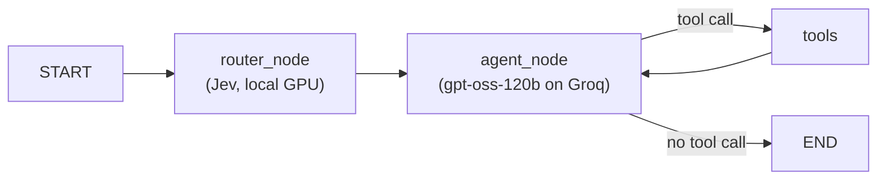

# ClinicDesk + Jev

A LangGraph front-desk agent for a dental clinic that uses a local **Jev** router to decide which
tools the LLM gets on each turn. Jev (via [open-alternative-jev](https://github.com/ikermoel/open-alternative-jev))
classifies the user's message in a single forward pass of a small open-weights model and returns a
typed choice with a calibrated confidence. The agent then binds only the tools that message needs,
instead of sending all 10 tool schemas to the LLM on every call.

On a benchmark of 82 questions this cut Groq token use by **51%** and mean latency from 9.4 s to
5.4 s, with no loss in reaching the right tool.

## How the routing works



`router_node` asks Jev one question per turn: which of the 10 tools, or `general_chat`, does this
message need? The answer maps to one of three outcomes:

| Jev's answer | Tools bound to the LLM |
| --- | --- |
| A tool, confidence >= 0.75 | That tool plus the lookups it depends on (`TOOL_GROUPS`) |
| `general_chat`, confidence >= 0.75 | None: the LLM answers directly |
| Anything below 0.75 | All 10 tools (safe fallback) |

Write tools need ids that only the read tools can find, so a confident `book_appointment` also
binds `search_patient`, `list_doctors`, `check_availability` and `register_patient`. Otherwise the
agent could not look up the patient, doctor or slot it is booking. See
[src/clinic_zero/router.py](src/clinic_zero/router.py).

Jev's raw label and confidence are stored in the graph state (`jev_label`, `jev_confidence`), and
every routing decision is traced to LangSmith as a `jev_router` run.

## Benchmark results

100 labelled questions (10 tools + general chat, 5 in Arabic or Egyptian Arabic), each run once with
Jev and once with the baseline graph that always binds all 10 tools. 82 have run so far; the run
stopped at Groq's free-tier daily cap of 200K tokens.

| Category | n | Tokens with Jev | Tokens baseline | Saved |
| --- | --- | --- | --- | --- |
| Treatment price | 10 | 993 | 3,362 | 70% |
| Clinic info | 10 | 786 | 2,056 | 62% |
| Patient search | 9 | 756 | 1,872 | 60% |
| List doctors | 9 | 837 | 2,055 | 59% |
| Patient history | 10 | 1,288 | 3,031 | 58% |
| Reschedule | 6 | 1,799 | 3,985 | 55% |
| Availability | 10 | 1,458 | 2,813 | 48% |
| Cancel | 8 | 1,210 | 2,254 | 46% |
| Book appointment | 10 | 2,658 | 2,757 | 4% |
| **All** | **82** | **1,300** | **2,652** | **51%** |

Mean Groq tokens per question. Jev runs locally, so it adds no API tokens.

- **Router:** picked the expected tool on 74/82 (90%). All 72 confident picks were correct; the other
  10 fell back to all tools, so no turn was left without a tool it needed.
- **Quality:** both graphs reached the expected tool on 58/58 lookup and chat questions, 0 errors.
- **Weak spot:** booking. A booking needs several lookups first, so Jev spreads its confidence
  (mean 0.58) and 9 of 10 booking turns fell back to all tools.
- **Where the saving comes from:** input tokens (85K vs 193K). Fewer tools bound means fewer tool
  schemas in every request; output tokens barely changed (21K vs 24K).

Per-turn results are in [results/benchmark.jsonl](results/benchmark.jsonl).

## Setup

Requirements: Python 3.14, [uv](https://docs.astral.sh/uv/), an NVIDIA GPU with ~10 GB of VRAM for
the router, a [Groq](https://console.groq.com) API key, and optionally a
[LangSmith](https://smith.langchain.com) API key.

```bash
uv sync
```

This installs the CUDA 12.8 build of PyTorch (configured in `pyproject.toml`) and
`open-alternative-jev`. That package is **not on PyPI**: it installs from GitHub and is imported as
`so1`. `pip install open-alternative-jev` will fail.

Create `.env`:

```
GROQ_API_KEY=...
LANGSMITH_API_KEY=...
```

Build the demo database (fake patients, doctors, slots and prices):

```bash
uv run python seed.py
```

### Choosing the Jev model

The default is `Qwen/Qwen3.5-4B` in bf16 (about 8.4 GB of VRAM, 9 GB download). Override it with the
`JEV_MODEL` environment variable. The larger `Qwen/Qwen3.6-27B` from the open-alternative-jev README
needs about 30 GB of VRAM even in 8-bit.

## Usage

```bash
uv run clinic-zero                               # chat with the agent (Jev routing)
uv run clinic-zero --no-jev                      # chat with the baseline (all tools)
uv run python -m clinic_zero.benchmark           # run or resume the 100-question benchmark
uv run python -m clinic_zero.benchmark --report  # print the report from saved results
uv run python -m clinic_zero.compare             # quick 4-question comparison
```

Write actions (book, cancel, reschedule, register) pause for human approval. The benchmark
auto-declines them, so it never changes `clinic.db`.

The benchmark saves each turn as it finishes and resumes where it left off. It stops cleanly when
Groq's daily token cap is reached.

## Project layout

| Path | Contents |
| --- | --- |
| [src/clinic_zero/router.py](src/clinic_zero/router.py) | Jev router: labels, `TOOL_GROUPS`, confidence threshold |
| [src/clinic_zero/graph.py](src/clinic_zero/graph.py) | State, agent nodes, `build_graph(use_jev=...)` |
| [src/clinic_zero/tools.py](src/clinic_zero/tools.py) | The 10 clinic tools |
| [src/clinic_zero/db.py](src/clinic_zero/db.py) | SQLite connection, phone and date validation |
| [src/clinic_zero/benchmark.py](src/clinic_zero/benchmark.py) | 100-question benchmark and report |
| [src/clinic_zero/benchmark_questions.py](src/clinic_zero/benchmark_questions.py) | The labelled questions |
| [clinicdesk_with_jev (1).ipynb](<clinicdesk_with_jev (1).ipynb>) | Notebook version of the Jev graph |
| [seed.py](seed.py) | Builds `clinic.db` |

## Notes

- On Windows, the Hugging Face cache cannot create symlinks unless Developer Mode is on. Downloads
  still work, but enabling it avoids a `WinError 1314` on some files.
- The Groq free tier for `openai/gpt-oss-120b` allows 8K tokens per minute and 200K per rolling 24
  hours. The benchmark hit the daily cap after 164 of its 200 turns, so a full run takes two days on
  the free tier.
